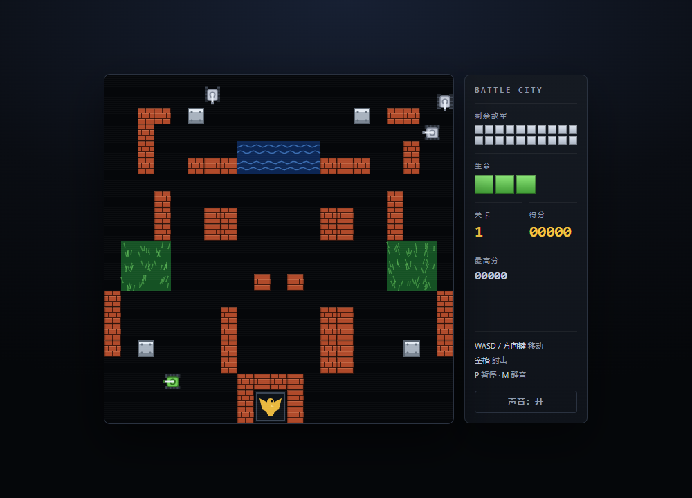

# 坦克大战 · Battle City

纯前端实现的经典坦克大战。零依赖、零构建，打开 `index.html` 就能玩。

**[▶ 在线试玩 · Play in browser](https://lhz0909.github.io/tank-battle/)**



## 玩法

守住屏幕下方的基地，消灭每一关的全部 20 辆敌方坦克。基地被摧毁或 3 辆战车全部损毁则游戏结束。

## 操作

| 操作 | 按键 |
| --- | --- |
| 移动 | `WASD` / 方向键 |
| 射击 | 空格 |
| 暂停 | `P` |
| 静音 | `M` |

手机上会显示虚拟方向键和开火按钮。

## 特性

- 3 个手工设计的关卡，2 种地形破坏与 3 种敌方坦克（普通 / 快速 / 重装）
- 砖墙可被炮弹击碎，钢铁不可摧毁，水面阻挡坦克但炮弹可越过，草地可隐藏行踪
- 敌方 AI 会追击玩家与基地、在对准时开火、绕开障碍
- 基地保护砖墙、出生无敌护盾、爆炸粒子、屏幕震动
- WebAudio 合成音效，无外部资源
- 自适应桌面 / 手机的响应式界面，最高分本地存档

## 运行

直接双击 `index.html`，或起一个静态服务器：

```bash
python -m http.server 8000
# 打开 http://localhost:8000
```

## 文件结构

```
index.html     页面结构、HUD、触屏控件
style.css      界面样式与响应式布局
game.js        游戏逻辑、渲染、音效
screenshot.png 游戏截图
```

## 技术说明

- Canvas 2D 渲染，固定 504×504 逻辑分辨率，CSS 缩放适配屏幕
- 21×21 瓦片地图，坦克在瓦片网格上移动并自动对齐通道
- 子弹按 4px 子步推进做碰撞检测，避免高速穿透
- 请求动画帧驱动，`dt` 限幅保证掉帧时逻辑稳定
